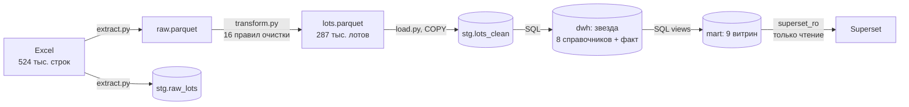
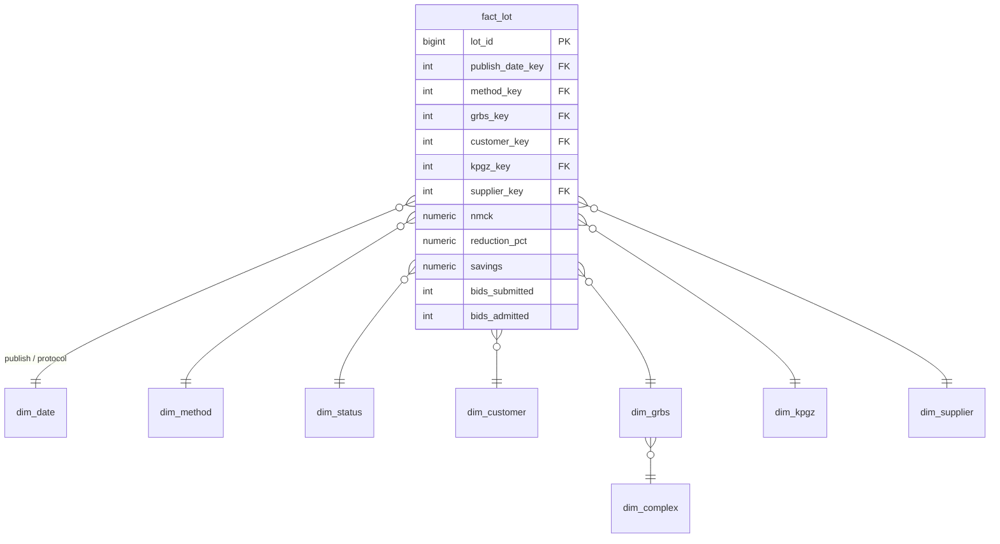

# Конкуренция в госзакупках Москвы, 2025

Сравнительный анализ конкуренции на торгах: ETL-пайплайн на Python, хранилище данных
в PostgreSQL (схема «звезда»), витрины на SQL и дашборд в Apache Superset.


## Главные выводы

1. **Конкуренция слабая.** Медиана — **1 заявка** на лот. **35%** конкурентных лотов прошли
   с одной заявкой, ещё **23,5%** — без заявок вообще.
2. **Каждый участник добавляет ~10 п.п. снижения цены.** Медианное снижение: 0% при одном
   участнике, 10% при двух, 24% при трёх, 34% при четырёх, 49% при пяти и более.
3. **Недополученная экономия — около 44 млрд ₽.** Столько сэкономил бы бюджет, если бы лоты
   с одним участником прошли со снижением, типичным для двух участников (10%).
   С учётом 162 мегалотов (НМЦК ≥ 1 млрд ₽) оценка — 309 млрд ₽, но она держится на единицах лотов.
4. **Две трети «экономии» в данных неправдоподобны.** 1 323 лота с одним участником показывают
   снижение > 25% и дают 124 из 183 млрд ₽ экономии; 10 лотов дают 71% всей суммы.
   Очищенная экономия — **60 млрд ₽**.
5. **Различия между ведомствами не объясняются только структурой закупок.** У Комплекса ЖКХ доля
   лотов с одним участником на **8,5 п.п. выше**, чем ожидается для его набора рынков (КПГЗ).
   Высокая доля у Комплекса социального развития (39%), напротив, объясняется составом закупок.
6. **27% объёма НМЦК — закупки у единственного поставщика.** В транспортном комплексе — 87%.
7. **Конкурсы конкурентны хуже аукционов:** 51% лотов с одной заявкой против 36%,
   медианное снижение 0,5% против 6,5%.

## Архитектура



| Слой | Технологии | Что происходит |
|---|---|---|
| Extract | pandas | копия источника + метаданные происхождения, контракт схемы |
| Transform | pandas, numpy | очистка, флаги качества, смена зерна «строка → лот», журнал качества |
| Load | SQLAlchemy, COPY, SQL | справочники и факт в одной транзакции, сверка со staging |
| Витрины | SQL (VIEW) | KPI, сравнение групп, HHI, динамика |
| BI | Apache Superset | дашборд с фильтрами, пользователь только на чтение |
| Инфраструктура | Docker Compose | PostgreSQL 18, Superset 4.1 |

## Модель данных

Зерно факта — **один лот**. Иерархия ГРБС → комплекс строгая (снежинка),
а заказчик → ГРБС — нет (у 301 заказчика несколько ГРБС), поэтому оба ключа хранятся в факте.



Ключевые решения:
- **суррогатные ключи** через `ROW_NUMBER()` — детерминированы между загрузками;
- **unknown member** (ключ 0 «Не указан») — лоты без КПГЗ или победителя не теряются при JOIN;
- **ограничения** `NOT NULL`, `CHECK`, `FOREIGN KEY` — последняя линия защиты качества;
- **вырожденные измерения** (`purchase_id`, `contract_id`) хранятся в факте.

Полная ER-диаграмма: [docs/er_diagram.png](docs/er_diagram.png).

## Особенности данных и правила очистки

Исходные данные — 524 219 строк. Одна строка — **не лот**: лот может повторяться
(серии контрактов единственного поставщика, плановые позиции в разных статусах).

| № | Обнаружено | Объём | Решение |
|---|---|---|---|
| 1 | Полные дубли строк | 5 808 | удалены |
| 2 | Две колонки «на единицу продукции» совпадают | 100% | одна колонка `is_per_unit` |
| 3 | Снижение вне 0–100% | 21 129 | флаг, исключено из метрик снижения |
| 4 | Протокол раньше публикации | 180 | флаг, длительность = NULL, лот сохранён |
| 5 | «Контракт = Нет», но номер заполнен | 5 025 | флаг, исходное значение не меняется |
| 6 | Разное написание победителей | 19 798 → 17 731 | нормализация названий и ОПФ |
| 7 | Три типа строк | 152 / 311 / 55 тыс. | `row_type`: конкурентная / прямая / плановая |
| 8 | Дубли конкурентных лотов | 6 074 лота | одна представительная строка на лот |
| 9 | Серии контрактов единственного поставщика | 14 651 лот | снижение = минимум валидных значений |
| 10 | 0 заявок, допущенные пусты | 34 895 | допущено = 0, флаг `no_bids` |
| 11 | НМЦК пустая | 1 044 | исключено из денежных метрик |
| 12 | 12 способов закупки | — | 6 групп |
| 13 | «Совместная закупка»: «Нет» или число | 31 287 | `is_joint` + `joint_size` |
| 14 | Даты строками, номера во float | — | приведение типов |
| 15–16 | Пустые комплекс и статус | 7 292 / 4 | «Не указан» |

Принцип: **удаляется только то, что не несёт информации** (полные дубли).
Всё остальное помечается флагами — решения обратимы, а их эффект виден в журнале качества.

**Правило витрины.** Лот с ≤ 1 допущенным участником и снижением > 25% помечается как
«подозрительная экономия» и не входит в очищенную сумму. Порог — уровень антидемпинговых мер 44-ФЗ.
Это аналитическое допущение, поэтому оно реализовано в витрине, а не в очистке.

## Ограничения

- Данные за 2025 год; динамика между годами недоступна.
- У 62% лотов нет победителя, у 11% — КПГЗ: анализ концентрации строится на подмножестве.
- «Снижение» в сериях контрактов единственного поставщика интерпретировано как неосвоенный лимит
  нарастающим итогом (гипотеза проверена частично: ~54% шагов убывают, у 19% лотов есть «сбросы»).
- Закупки на единицу продукции исключены из денежных метрик: их снижение относится к ценам единиц.
- Идентификаторы заказчиков и ГРБС анонимизированы.

## Структура репозитория

```
etl/          extract.py, transform.py, load.py, config.py
sql/          01 схема · 02 календарь · 03 справочники · 04 факт · 05 сверка · 06 витрины · 07 доступ BI
notebooks/    01_eda.ipynb — исследование данных; 02_transform_check.ipynb — проверка результата
docker/       postgres/init, superset (Dockerfile, конфиг)
superset/     exports/ — экспорт дашборда; screenshots/
docs/         er_diagram.png
```

## Запуск

Требуется: Docker Desktop, Python 3.11+.

```bash
# 1. Окружение
cp .env.example .env                    # задать пароли и SUPERSET_SECRET_KEY
python3 -m venv .venv && source .venv/bin/activate
pip install -r requirements.txt

# 2. Инфраструктура
docker compose up -d --build            # PostgreSQL :5433, Superset http://localhost:8088

# 3. Данные: положить исходный файл в data/raw/
python -m etl.extract                   # ~1,5 мин (чтение Excel)
python -m etl.transform                 # ~5 с
python -m etl.load                      # ~40 с, в конце — сверка 8/8

# 4. Доступ для BI (один раз)
#    выполнить sql/07_bi_access.sql от имени ETL-пользователя

# 5. Дашборд: Superset → Dashboards → Import → superset/exports/dashboard.zip
```

Пайплайн идемпотентен: повторный запуск пересобирает хранилище целиком, без дублей.